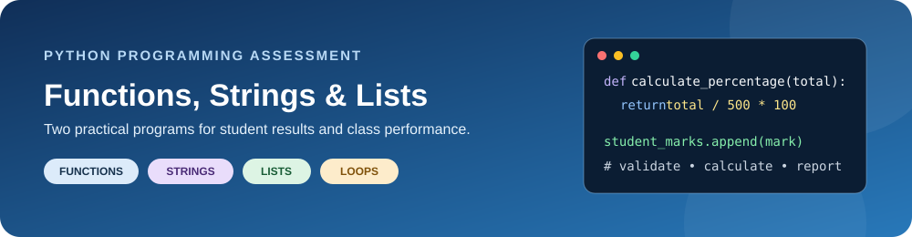
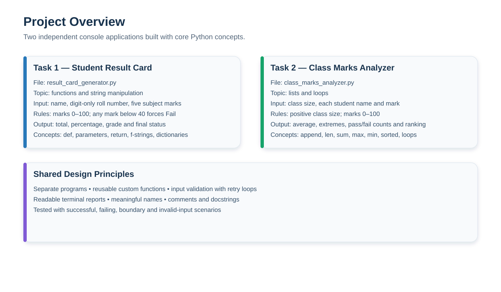
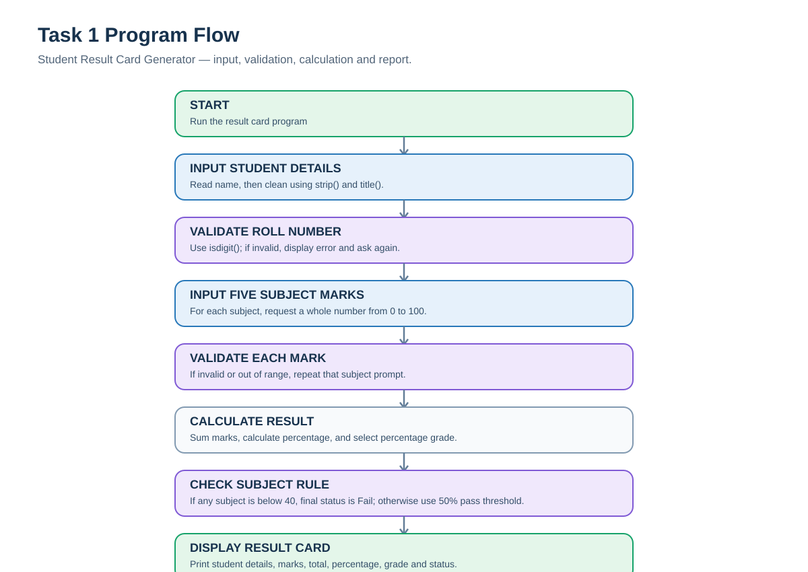
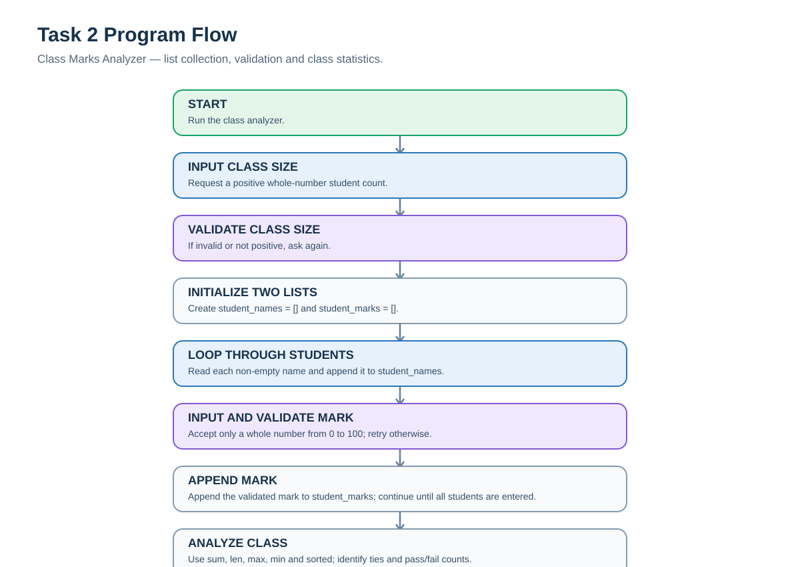
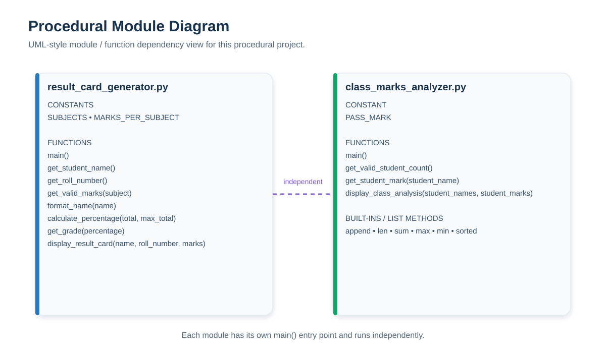

<p align="center"></p>

# Python Functions, Strings and Lists Assessment

## 1. Project Overview

This repository contains two independent command-line Python programs. The first generates an individual student's result card; the second analyzes marks for a whole class.

| Task | File | Topics |
|---|---|---|
| Student Result Card Generator | `result_card_generator.py` | Functions, parameters, return values, strings, dictionaries and f-strings |
| Class Marks Analyzer | `class_marks_analyzer.py` | Lists, list methods, built-in functions, loops and conditions |



## 2. Folder Structure

```text
python-functions-lists-assessment/
├── result_card_generator.py
├── class_marks_analyzer.py
├── README.md
└── assets/
    ├── banner.svg
    ├── overview.svg
    ├── result_card_flow.svg
    ├── class_analyzer_flow.svg
    ├── uml_diagram.svg
    ├── banner.png
    ├── overview.png
    ├── result_card_flow.png
    ├── class_analyzer_flow.png
    └── uml_diagram.png
```

## 3. Task 1 — Student Result Card Generator

### Summary

`result_card_generator.py` collects a student's name, roll number and marks in five subjects. It calculates the total, percentage and percentage-based letter grade, then prints a formatted result card.

### Rules and requirements

- Each subject mark must be a whole number from 0 through 100.
- The roll number must contain digits only, checked with `.isdigit()`.
- The name is cleaned with `.strip()` and `.title()`.
- Grades: 90+ A+, 80–89 A, 70–79 B, 60–69 C, 50–59 D, below 50 Fail.
- A mark below 40 in any subject overrides the overall pass decision and makes the final status **Fail**.
- The letter grade remains percentage-based; the separate final status applies the individual-subject rule.

### Program Flow



### Code Methods Description

| Method or section | Purpose |
|---|---|
| `get_valid_marks(subject)` | Re-prompts until a valid whole-number mark from 0–100 is entered. |
| `calculate_percentage(total, max_total)` | Returns the overall percentage. |
| `get_grade(percentage)` | Maps the percentage to the required letter grade. |
| `format_name(name)` | Cleans and title-cases the student's name. |
| `get_student_name()` | Collects a non-empty student name. |
| `get_roll_number()` | Validates the roll number using `.isdigit()`. |
| `display_result_card(name, roll_number, marks)` | Calculates and prints the result card. |
| `main()` | Coordinates input collection and result generation. |

### Input Validation

- Blank names are rejected.
- Roll numbers containing anything other than digits are rejected.
- Non-integer marks and marks outside 0–100 are rejected and requested again.
- The program accepts leading zeros in roll numbers, such as `00125`.

### Expected Results

The program displays all five subject marks, total marks out of 500, percentage to two decimal places, letter grade and final Pass/Fail status. A subject mark below 40 forces the final status to Fail.

## 4. Task 2 — Class Marks Analyzer

### Summary

`class_marks_analyzer.py` collects a class size, student names and marks. It stores names and marks in separate lists and reports class statistics, pass/fail counts, above-average students and a descending ranking.

### Rules and requirements

- The class size must be a positive whole number.
- Each student name must not be blank.
- Each mark must be a whole number from 0 through 100.
- A student passes with 50 marks or above; below 50 is a fail.
- Students tied for highest or lowest marks are all displayed.
- “Above average” means strictly greater than the class average.

### Program Flow



### Code Methods Description

| Method or section | Purpose |
|---|---|
| `get_valid_student_count()` | Collects and validates a positive class size. |
| `get_student_mark(student_name)` | Collects and validates a student's mark. |
| `display_class_analysis(student_names, student_marks)` | Calculates statistics and prints the class report. |
| `main()` | Collects student data in two lists and calls the analysis function. |
| `student_names.append()` | Adds each validated name to the names list. |
| `student_marks.append()` | Adds each validated mark to the marks list. |
| `sorted()` | Sorts name/mark pairs from highest to lowest mark. |

### Input Validation

- Class size must be an integer greater than zero.
- Blank names are rejected.
- Marks must be whole numbers from 0 to 100; invalid values trigger another prompt.
- The program does not proceed with an empty class.

### Expected Results

The report includes class average, highest and lowest marks with all tied students, passing and failing counts, students above the average, and all students sorted from highest to lowest.

## 5. UML Diagram

A **procedural module diagram** is used because the solution consists of two independent Python modules containing functions rather than classes. It shows each file's constants, functions and independent entry point.



## 6. Concepts and Techniques Used

- Function definitions with `def`, parameters and `return`.
- String methods: `.strip()`, `.title()` and `.isdigit()`.
- Input validation with `while` loops and `try/except`.
- Dictionaries to associate subjects with marks.
- Lists created with `[]` and populated using `.append()`.
- Built-in functions: `len()`, `sum()`, `max()`, `min()` and `sorted()`.
- `for` loops, conditional statements, list comprehensions and `zip()`.
- f-strings, including two-decimal percentage formatting.
- Constants, docstrings and a `main()` entry point in each file.

## 7. How to Run

### Requirements

- Python 3.8 or newer.
- No third-party Python packages are required to run either program.

### Clone the repository

After creating the repository under the GitHub username `waleedshehbazdev`, run:

```bash
git clone https://github.com/waleedshehbazdev/python-functions-lists-assessment.git
cd python-functions-lists-assessment
```

### Run Task 1

```bash
python result_card_generator.py
```

Alternative commands:

```bash
python3 result_card_generator.py
py result_card_generator.py
```

### Run Task 2

```bash
python class_marks_analyzer.py
```

Alternative commands:

```bash
python3 class_marks_analyzer.py
py class_marks_analyzer.py
```

## 8. Sample Execution

The following transcripts are captured from actual program runs during testing.

### Task 1 — Successful result card

Input: Alice Johnson, roll number `00125`, marks `95, 88, 92, 90, 85`.

```text
STUDENT RESULT CARD GENERATOR
Enter student name: Enter roll number: Enter marks for English (0-100): Enter marks for Mathematics (0-100): Enter marks for Science (0-100): Enter marks for Computer (0-100): Enter marks for Urdu (0-100): 
==========================================
             STUDENT RESULT CARD
==========================================
Student Name : Alice Johnson
Roll Number  : 00125
------------------------------------------
Subject                  Marks
------------------------------------------
English                     95
Mathematics                 88
Science                     92
Computer                    90
Urdu                        85
------------------------------------------
Total Marks                450 / 500
Percentage   : 90.00%
Letter Grade : A+
Final Status : Pass
==========================================
```

### Task 1 — Subject-below-40 failure case

Input: Sara Khan, roll number `42`, marks `100, 100, 35, 100, 100`. The percentage grade is A, but the final status is Fail because one subject is below 40.

```text
STUDENT RESULT CARD GENERATOR
Enter student name: Enter roll number: Enter marks for English (0-100): Enter marks for Mathematics (0-100): Enter marks for Science (0-100): Enter marks for Computer (0-100): Enter marks for Urdu (0-100): 
==========================================
             STUDENT RESULT CARD
==========================================
Student Name : Sara Khan
Roll Number  : 42
------------------------------------------
Subject                  Marks
------------------------------------------
English                    100
Mathematics                100
Science                     35
Computer                   100
Urdu                       100
------------------------------------------
Total Marks                435 / 500
Percentage   : 87.00%
Letter Grade : A
Final Status : Fail
Note         : At least one subject mark is below 40.
==========================================
```

### Task 2 — Class analysis

Input: Ali 80, Sara 45, Hassan 90 and Ayesha 60.

```text
CLASS MARKS ANALYZER
How many students are in the class? 
Student 1
Enter student name: Enter marks for Ali (0-100): 
Student 2
Enter student name: Enter marks for Sara (0-100): 
Student 3
Enter student name: Enter marks for Hassan (0-100): 
Student 4
Enter student name: Enter marks for Ayesha (0-100): 
================================================
               CLASS MARKS ANALYSIS
================================================
Number of students : 4
Class average      : 68.75
Highest marks      : 90 (Hassan)
Lowest marks       : 45 (Sara)
Passing students   : 3
Failing students   : 1

Students above class average:
- Ali: 80
- Hassan: 90

Marks sorted from highest to lowest:
- Hassan: 90
- Ali: 80
- Ayesha: 60
- Sara: 45
================================================
```

### Task 2 — Boundary case

Input: Noor 0 and Bilal 100.

{fenced_output(out2_edge)}

### Task 2 — Tied highest and lowest marks

Input: Amna 90, Hamza 90, Noor 40 and Zain 40.

```text
CLASS MARKS ANALYZER
How many students are in the class? 
Student 1
Enter student name: Enter marks for Amna (0-100): 
Student 2
Enter student name: Enter marks for Hamza (0-100): 
Student 3
Enter student name: Enter marks for Noor (0-100): 
Student 4
Enter student name: Enter marks for Zain (0-100): 
================================================
               CLASS MARKS ANALYSIS
================================================
Number of students : 4
Class average      : 65.00
Highest marks      : 90 (Amna, Hamza)
Lowest marks       : 40 (Noor, Zain)
Passing students   : 2
Failing students   : 2

Students above class average:
- Amna: 90
- Hamza: 90

Marks sorted from highest to lowest:
- Amna: 90
- Hamza: 90
- Noor: 40
- Zain: 40
================================================
```

```text
CLASS MARKS ANALYZER
How many students are in the class? 
Student 1
Enter student name: Enter marks for Noor (0-100): 
Student 2
Enter student name: Enter marks for Bilal (0-100): 
================================================
               CLASS MARKS ANALYSIS
================================================
Number of students : 2
Class average      : 50.00
Highest marks      : 100 (Bilal)
Lowest marks       : 0 (Noor)
Passing students   : 1
Failing students   : 1

Students above class average:
- Bilal: 100

Marks sorted from highest to lowest:
- Bilal: 100
- Noor: 0
================================================
```

## 9. Test Cases

### Task 1 test cases

| # | Scenario | Inputs | Expected result |
|---:|---|---|---|
| 1 | Successful high score | Alice Johnson; `00125`; 95, 88, 92, 90, 85 | 90.00%, A+, Pass |
| 2 | Subject mark below 40 | Sara Khan; `42`; 100, 100, 35, 100, 100 | A percentage grade, final status Fail |
| 3 | Invalid roll number | `abc`, then `007` | Reject `abc`; accept `007` |
| 4 | Invalid mark boundaries | `-1`, `101`, then valid marks | Reject out-of-range marks and re-prompt |
| 5 | Non-numeric mark | `abc`, then valid marks | Reject non-integer mark and re-prompt |
| 6 | Name whitespace | `  aLIce johnson  ` | Display `Alice Johnson` |
| 7 | Below-50 grade | Omar Ali; `55`; 49 in all five subjects | Letter grade Fail and final status Fail |

### Task 2 test cases

| # | Scenario | Inputs | Expected result |
|---:|---|---|---|
| 1 | Mixed class results | Ali 80, Sara 45, Hassan 90, Ayesha 60 | Average 68.75; 3 pass, 1 fail |
| 2 | Lowest and highest boundaries | Noor 0, Bilal 100 | Lowest 0; highest 100 |
| 3 | Invalid class size | `zero`, `0`, then `2` | Reject invalid and non-positive counts |
| 4 | Blank student name | Blank, then `Ali` | Reject blank name and re-prompt |
| 5 | Invalid mark boundaries | `-5`, `101`, then valid marks | Reject out-of-range marks and re-prompt |
| 6 | Tied highest and lowest | Amna 90, Hamza 90, Noor 40, Zain 40 | Display both names for each tied extreme |

### Verification

- Both Python files were executed with real interactive inputs.
- Successful and failing result-card scenarios were checked.
- Invalid roll number, non-numeric marks, negative marks and marks above 100 were tested.
- Invalid class size, blank student name and invalid marks were tested.
- Boundary marks 0 and 100 were tested; tied highest and lowest marks were also verified.
- Python syntax compilation and SVG XML validation were performed.
- PNG rendering status: All SVG files validated and rendered to PNG.

## Author

**Hira Aslam**  
GitHub: [its-hiraaslam](https://github.com/its-hiraaslam)
